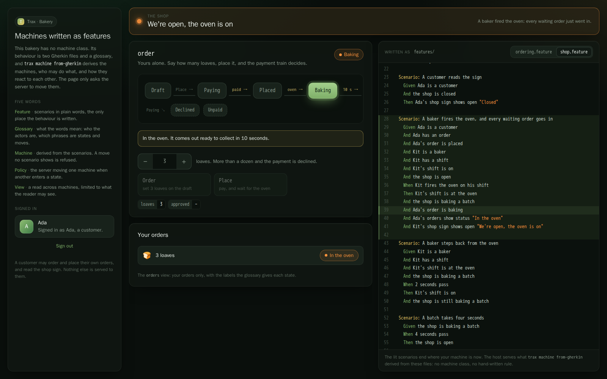

# Bakery

Pre-orders for a bakery, with machines written only as features. A team writes what happens in Gherkin and a
glossary of its words; `trax machine from-gherkin` derives the machines from them, with who may do what; the host
serves them as committed. There is no C# machine class and no hand-written rule. The one piece of C# behind the
machines is the payment train an order invokes.



| You write | Trax derives |
| --- | --- |
| [`features/ordering.feature`](features/ordering.feature), [`features/shop.feature`](features/shop.feature) | One IR per machine in [`machines/`](machines/) |
| [`features/glossary.json`](features/glossary.json): actors, machines, states, phrases, views | [`machines/host.json`](machines/host.json): owners, access, policies, views, and the scenarios behind each part |
| | [`machines/access.txt`](machines/access.txt): every grant, one line each, reviewed in a pull request |

## What it shows

- 🟤 Two actors: a **customer** owns orders, a **baker** owns shifts. Each person signs in on a page of their own.
- 🟡 Three machines: a customer's **order**, a baker's **shift**, and **the shop**, one system-owned instance at
  `shop/main` that the host starts.
- 🔵 `Order` and `Place`: an order with nothing in it is refused with "Add something first.", a guard the features
  show.
- 💟 Placing invokes the payment train: up to a dozen loaves goes through, more is declined.
- 🟣 A baker clocking in opens the shop and clocking out closes it (policies from a user's machine to the system's). A
  baker firing the oven makes the shop bake a batch, and every paid order waiting for it goes in (a broadcast). An
  order comes out ready to collect ten seconds later (a timer), and a baker steps back from the oven after two.
- 🟢 Two views: **orders**, a customer's own orders, and **shop sign**, which every customer and baker reads.

## Run it

From the `Trax.Samples` folder, with Docker running:

```bash
samples/Bakery/demo.sh
```

Then open http://localhost:5281 in two windows. Sign in as Ada, a customer, in one, and Kit, a baker, in the other.
Ada orders loaves and places her order. Kit clocks in, which opens the shop, and fires the oven; Ada's order goes
in, and is ready to collect ten seconds later. The operations console is at
http://localhost:5282/trax/dashboard: sign in with a token for the `operator` role, and its machine pages have a
**Board** tab drawn from the features.

Sign-in is a token per person from `POST /dev/token`, Development only, signed with a demo key the host refuses to
start with anywhere else. Outside Development the host has no sign-in, so it serves nothing.

## Change a feature

Edit `features/`, then derive the machines again and run the features on them, from the repository root:

```bash
dotnet run --project Trax.Cli/src/Trax.Cli -- machine from-gherkin \
  --features Trax.Samples/samples/Bakery/features --out Trax.Samples/samples/Bakery/machines
dotnet run --project Trax.Cli/src/Trax.Cli -- machine run \
  --features Trax.Samples/samples/Bakery/features --machines Trax.Samples/samples/Bakery/machines
dotnet run --project Trax.Cli/src/Trax.Cli -- machine missing --features Trax.Samples/samples/Bakery/features
```

`from-gherkin` refuses features that contradict each other, or that would derive a machine the host refuses, and says
where. `access.txt` changes whenever who may do what does. Then write the page's client again from the host:

```bash
(cd Trax.Samples/samples/Bakery/Trax.Samples.Bakery.Api && dotnet run -- --trax-export-client ../Trax.Samples.Bakery.Web/src/trax/manifest.json)
(cd Trax.Samples/samples/Bakery/Trax.Samples.Bakery.Web && dotnet run --project ../../../../Trax.Cli/src/Trax.Cli -- client \
  --manifest src/trax/manifest.json --out src/trax)
```

CI runs `trax client --check` and fails when the committed client is out of date. The committed machines are checked
by [`InMemoryRunTests`](../../tests/Trax.Samples.Bakery.E2E/InMemoryRunTests.cs), which fails when they are not what
the features derive.

## Tests

The same features run two ways:

- **In memory**, on the committed machines, as `trax machine run` runs them:
  [`InMemoryRunTests`](../../tests/Trax.Samples.Bakery.E2E/InMemoryRunTests.cs). It also checks the committed machines
  are what the features derive, and that the glossary names nothing the features leave out.
- **Against the host**, through the Reqnroll bindings of `Trax.StateMachine.Gherkin.Reqnroll`, every person a user of
  their own: [`Hooks`](../../tests/Trax.Samples.Bakery.E2E/Hooks.cs) and the feature files themselves. The host
  requires persisted operations as it ships, and the bindings send each step by the id the page's manifest holds. The two
  scenarios whose outcome the real payment train never produces by itself (a payment that fails, one that is called
  off) are tagged `@in-memory` and run in memory only.

The page has browser tests of its own, written by hand rather than run from the features:
[`BakeryPageTests`](../../tests/Trax.Samples.Bakery.Browser/BakeryPageTests.cs), a customer and a baker on pages of
their own telling the same story, and the built page carrying no credential. A new scenario is not checked on the page
until a test there is written for it.
