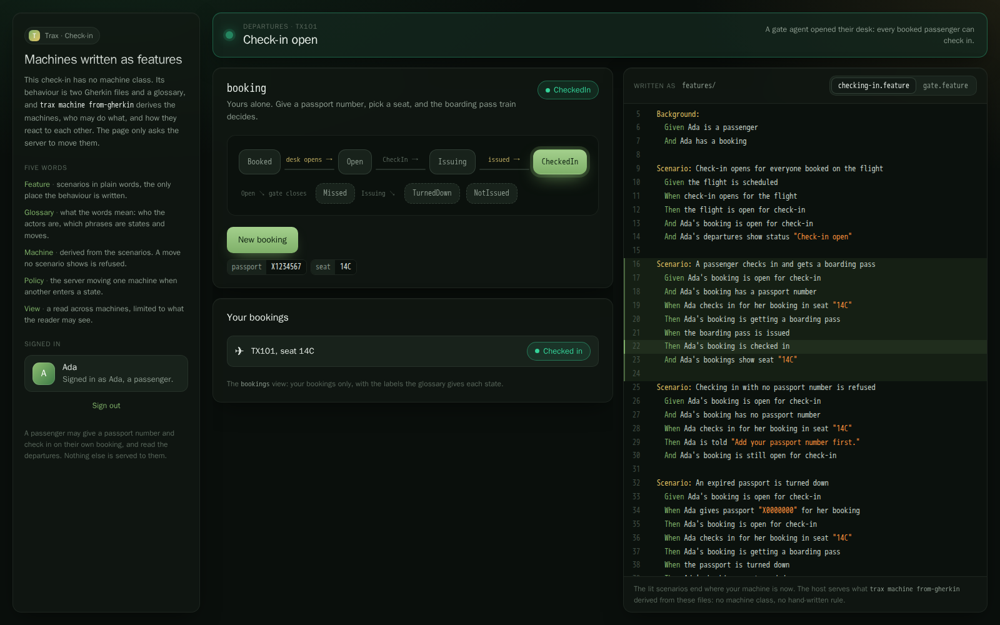

# CheckIn

Online check-in for a flight, with machines written only as features. A team writes what happens in Gherkin and a
glossary of its words; `trax machine from-gherkin` derives the machines from them, with who may do what; the host
serves them as committed. There is no C# machine class and no hand-written rule. The one piece of C# behind the
machines is the boarding pass train a booking invokes.



| You write | Trax derives |
| --- | --- |
| [`features/checking-in.feature`](features/checking-in.feature), [`features/gate.feature`](features/gate.feature) | One IR per machine in [`machines/`](machines/) |
| [`features/glossary.json`](features/glossary.json): actors, machines, states, phrases, views | [`machines/host.json`](machines/host.json): owners, access, policies, views, and the scenarios behind each part |
| | [`machines/access.txt`](machines/access.txt): every grant, one line each, reviewed in a pull request |

## What it shows

- 🟤 Two actors: a **passenger** owns bookings, a **gate agent** owns desks. Each person signs in on a page of their
  own.
- 🟡 Three machines: a passenger's **booking**, a gate agent's **desk**, and **the flight**, one system-owned instance
  at `flight/tx101` that the host starts.
- 🔵 `GivePassport` and `CheckIn`: checking in with no passport number is refused with "Add your passport number
  first.", a guard the features show, and checking in before check-in opens has no move at all.
- 💟 Checking in invokes the boarding pass train: a passport number ending in 0 has expired and is turned down, any
  other is accepted.
- 🟣 A gate agent opening their desk opens check-in on the flight, and closing the gate there closes it (policies from
  a user's machine to the system's). The flight opening opens every booked booking, and closing makes every booking
  still open miss the flight (broadcasts). The desk is done two seconds after the gate closes, the flight departs
  four seconds after, and the next flight is scheduled ten seconds after that (timers).
- 🟢 Two views: **bookings**, a passenger's own bookings with their seat, and **departures**, which every passenger
  and gate agent reads.

## Run it

From the `Trax.Samples` folder, with Docker running:

```bash
samples/CheckIn/demo.sh
```

Then open http://localhost:5281 in two windows. Sign in as Ada, a passenger, in one, and Kit, a gate agent, in the
other. Ada's booking waits until Kit opens his desk, which opens check-in. Ada gives her passport number and checks
in to a seat, and gets a boarding pass. When Kit closes the gate, anyone still not checked in misses the flight. A
booking made after check-in opened waits for the next flight. The operations console is at
http://localhost:5282/trax/dashboard: sign in with a token for the `operator` role, and its machine pages have a
**Board** tab drawn from the features.

Sign-in is a token per person from `POST /dev/token`, Development only, signed with a demo key the host refuses to
start with anywhere else. Outside Development the host has no sign-in, so it serves nothing.

## Change a feature

Edit `features/`, then derive the machines again and run the features on them, from the repository root:

```bash
dotnet run --project Trax.Cli/src/Trax.Cli -- machine from-gherkin \
  --features Trax.Samples/samples/CheckIn/features --out Trax.Samples/samples/CheckIn/machines
dotnet run --project Trax.Cli/src/Trax.Cli -- machine run \
  --features Trax.Samples/samples/CheckIn/features --machines Trax.Samples/samples/CheckIn/machines
dotnet run --project Trax.Cli/src/Trax.Cli -- machine missing --features Trax.Samples/samples/CheckIn/features
```

`from-gherkin` refuses features that contradict each other, or that would derive a machine the host refuses, and says
where. `access.txt` changes whenever who may do what does. Then write the page's client again from the host:

```bash
(cd Trax.Samples/samples/CheckIn/Trax.Samples.CheckIn.Api && dotnet run -- --trax-export-client ../Trax.Samples.CheckIn.Web/src/trax/manifest.json)
(cd Trax.Samples/samples/CheckIn/Trax.Samples.CheckIn.Web && dotnet run --project ../../../../Trax.Cli/src/Trax.Cli -- client \
  --manifest src/trax/manifest.json --out src/trax)
```

CI runs `trax client --check` and fails when the committed client is out of date. The committed machines are checked
by [`InMemoryRunTests`](../../tests/Trax.Samples.CheckIn.E2E/InMemoryRunTests.cs), which fails when they are not what
the features derive.

## Tests

The same features run two ways:

- **In memory**, on the committed machines, as `trax machine run` runs them:
  [`InMemoryRunTests`](../../tests/Trax.Samples.CheckIn.E2E/InMemoryRunTests.cs). It also checks the committed machines
  are what the features derive, and that the glossary names nothing the features leave out.
- **Against the host**, through the Reqnroll bindings of `Trax.StateMachine.Gherkin.Reqnroll`, every person a user of
  their own: [`Hooks`](../../tests/Trax.Samples.CheckIn.E2E/Hooks.cs) and the feature files themselves. The host
  requires persisted operations as it ships, and the bindings send each step by the id the page's manifest holds. The two
  scenarios whose outcome the real boarding pass train never produces by itself (one that fails, one that is called
  off) are tagged `@in-memory` and run in memory only. The tag is this sample's: a `BeforeScenario` hook in `Hooks`
  skips it on the host. Trax gives meaning to no tag but `@host`.

The page has browser tests of its own, written by hand rather than run from the features:
[`CheckInPageTests`](../../tests/Trax.Samples.CheckIn.Browser/CheckInPageTests.cs), a gate agent and three passengers on pages of
their own telling the same story, and the built page carrying no credential. A new scenario is not checked on the page
until a test there is written for it.
