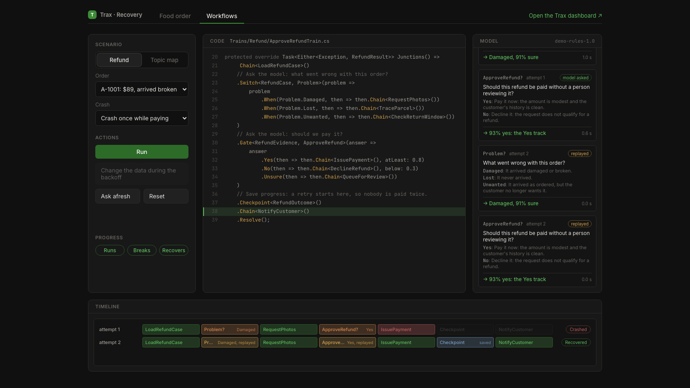

# Trax Recovery Sample

A live demo of a crashed run retrying without paying for its model's answers twice. A train asks a
decider (a stand-in model, or [Nimble](#using-nimble) running on your machine) which track to take, and Trax records each answer with a hash of the state
it was about. A later step crashes, and the manifest's automatic retry reuses the recorded answers
while that hash still matches, so it takes the same tracks. Every junction, question and track
reaches the page as it happens, through junction events. A second scenario, the topic map, runs three
similarity signals side by side in [parallel branches](#the-topic-map), crashes one, and draws each attempt
on the train's declared graph. Two state machines run trains too: one system-owned instance per partition of a
scholarly index ingests it, and each user builds their own topic map through a wizard whose `Building` state runs
the map's train, and a food order whose `Ordered` state delivers it is the page's first view. See
[the state machines](#the-state-machines).



It proves three Trax features working together: [train decisions](https://traxsharp.net/docs/core/decisions),
[retries that replay decisions](https://traxsharp.net/docs/scheduler/how-retries-work#retries-replay-decisions)
and [junction events](https://traxsharp.net/docs/effect/junction-events). The full walkthrough is on
[traxsharp.net/docs/samples/recovery](https://traxsharp.net/docs/samples/recovery).

```
Recovery/
├── Trax.Samples.Recovery/          Trains, junctions, the two state machines, the demo decider, the fault injector, the corpus
├── Trax.Samples.Recovery.Api/      One host: GraphQL + scheduler + local workers + dashboard
└── Trax.Samples.Recovery.Client/   React 19 + Vite + Apollo + graphql-ws page
```

## Run it

Needs the .NET 10 SDK, Node.js 20 or later, and Docker. From the `Trax.Samples` folder:

```bash
docker compose up -d database          # Postgres 5432, database trax_recovery
dotnet run --project samples/Recovery/Trax.Samples.Recovery.Api
```

In a second terminal:

```bash
cd samples/Recovery/Trax.Samples.Recovery.Client
npm ci
npm run dev
```

Open http://localhost:5173. The host listens on http://localhost:5260; the dashboard is at
http://localhost:5260/trax and the GraphQL IDE at http://localhost:5260/trax/graphql, both in
Development only. When your Postgres is not on 5432, start the host with
`ConnectionStrings__TraxDatabase="Host=localhost;Port=<port>;Database=trax_recovery;Username=trax;Password=trax123"`.

## Try it

The page has two views, both live against the host. Each has the controls on the left, the real C# with the acting
line lit, and a timeline drawn as a fixed grid under them.

**Food order** (the page opens on it) has a laptop panel, the code of `OrderMachine.cs` (and of
`DeliverOrderTrain.cs` while the order's run is on its junctions; the file tabs flip them by hand), and a phone that
follows the order on a socket of its own. Pick a scenario and press **Place order**: the laptop starts an order, adds
a Margherita (priced by the server) and presses Place order twice under one request id, as a double click sends it.

1. **Order a pizza.** One order, one run of `DeliverOrderTrain` (`SendToRestaurant`, `ChargeCard`, `Cook`,
   `PickUp`, `Deliver`), and the run's outcome moves the order to `Delivered`. The phone hears every change.
2. **The restaurant's tablet times out.** The tablet does not answer once, `SendToRestaurant` tries it again inside
   the same run, and the order is delivered; the `SendToRestaurant` box is marked **attempt 2**.
3. **The restaurant is closed.** The run fails before `ChargeCard` and the order is `Cancelled`, with nothing
   charged.
4. **Left in the cart.** The button reads **Leave it in the cart**: the order is filled and never placed, and the
   cart's timer clears it on the server. The timer is 30 minutes; to watch it fire, start the host with
   `Recovery__CartWait=00:00:15 Recovery__MachineSweepInterval=00:00:01` (without the second, the timer fires at the
   next sweep of the machines, up to a minute after it is due). **Reset** discards an order still in its cart.

**Workflows** has the train's code, a **Model** panel with one card per question (its instructions and options, the
answer, and whether it was asked or replayed), and one timeline row per attempt, with a box per junction, question,
track and checkpoint. The **Progress** pills follow the run: **Runs**, **Breaks** when an attempt crashes,
**Recovers** when the retry runs.

1. Leave **Refund**, order **A-1001** and **Crash once while emailing** selected and press **Run**. Attempt 1 runs
   `LoadRefundCase`, asks the model `Problem` (`Damaged`, 91% sure), runs `RequestPhotos`, asks `ApproveRefund`
   (93% yes: the `Yes` track), pays, stores the `RefundOutcome` in a checkpoint (its box reads **saved**) and crashes
   in `NotifyCustomer`. A few seconds later the manifest's retry starts from the checkpoint: its row marks every box
   before it **restored** and runs only `NotifyCustomer`. No question is put to the model and nothing is paid twice.
   **Change the data** and **Ask afresh** are not offered during this backoff: both questions come before the
   checkpoint.
2. Pick **Crash once while paying** and press **Run**. Attempt 1 crashes in `IssuePayment`, before the checkpoint.
   The retry runs the chain from the top and replays both answers (**replayed**), so it takes the same tracks, pays
   and emails the customer.
3. Press **Run** again and, while the retry counts down, press **Change the data during the backoff**: it adds an
   earlier refund to the order. Both questions are about a state that holds the earlier refunds, so neither hashes
   the same, both replays are refused and the model is asked again (**asked afresh: state changed**). The refund
   goes to a person (the `Unsure` track, `QueueForReview`) instead of being paid.
4. Press **Run** again and, during the countdown, press **Ask afresh**. The retry starts at once and asks the model
   both questions again (**asked afresh: on purpose**).
5. Try orders A-1002 and A-1003. The model says A-1002 never arrived (`TraceParcel`) and is unsure about paying it,
   and says A-1003 is unwanted (`CheckReturnWindow`) and declines it, so their runs take the review and decline
   tracks.
6. After a run completes, **Ask afresh** re-queues its last execution with `requeueExecution(id, askAfresh: true)`,
   as a run of its own: a `requeue` row.
7. **Resume from NotifyCustomer** appears only once a run is dead-lettered (every retry failed) and its latest
   failed attempt can resume there. It calls `resumeExecution(id, from: "NotifyCustomer#0")`, as the dashboard's
   **Resume from here** does, and follows the run in a `resume` row. While the run is alive its own retry already
   resumes from the checkpoint, and a run is resumed to completion once.
8. Pick **Topic map**, leave **Crash once** on, and press **Run**. Attempt 1 loads the papers and runs three branches
   at once: `embedding`, `cocitation` and `authors`. The `cocitation` branch asks the model `SameTopic` and crashes
   in the step on the track it picks. The run fails naming `Parallel#0/cocitation`, and the join, `CombineSignals`,
   never runs, so nothing is written. The retry replays the answer and writes the map. The three branches' boxes sit
   side by side in each row. The three slices on the picker take the gate's three tracks (`Yes`, `Unsure`, `No`).

The same over plain GraphQL, with header `X-Api-Key: recovery-operator-key-do-not-use-in-production`:

```graphql
mutation { dispatch { startRun(input: { scenario: REFUND, orderId: "A-1001", crashOnce: true, crashWhile: PAYING }) {
  output { runId manifestId manifestExternalId } } } }

query { operations { executions(manifestId: 1, order: OLDEST) { items { id trainState failureJunction } } } }

query { operations { junctionRuns(metadataId: 42) { position kind name state answer replayed attempt } } }
```

## The topic map

`BuildTopicMapTrain` maps a slice of 28 made-up papers, shaped like works from a scholarly index (title,
abstract, year, authors, references, concepts), held in a `topic_map` schema. The host creates the schema and
adds the papers at startup, skipping any already there. No network calls.

```
LoadCorpus → Parallel ─┬─ embedding:  EmbeddingSimilarity           (bag-of-words cosine)
                       ├─ cocitation: CountSharedReferences → Gate<SameTopic> → Trust / Dampen / Ignore
                       └─ authors:    AuthorOverlap
           → CombineSignals (the join: the only step that writes, in one transaction)
           → FindHiddenTwins (papers that read alike but cite nothing in common)
```

Branches compute; the join commits. `Parallel` is experimental, so the project opts in with
`<NoWarn>$(NoWarn);TRAXEXP001</NoWarn>`. Over GraphQL:

```graphql
mutation { dispatch { startRun(input: { scenario: TOPIC_MAP, crashOnce: true, fromYear: 2016, toYear: 2025 }) {
  output { runId manifestId } } } }

query { operations { runGraph(metadataId: 42) {
  nodes { id kind state tracks { name taken nodes { id state } } } } } }
```

## The state machines

All three live in `Trax.Samples.Recovery/Machines/` and use `Invokes`; the partitions use `IMachineInstances` too. A
state that invokes a train queues one run when it is entered, and only that entry receives the run's outcome.

**`source-partition`, one instance per index partition, owned by the system.** The host seeds 18 canned
OpenAlex and Crossref records, six partitions of three. `discoverPartitions` starts one instance per
`(source, month)` and sends it into `Ingesting`, which runs `IngestPartitionTrain`:

```
Discovered --Ingest--> Ingesting --done, unsure--> NeedsReview --Approve--> Approved
                         │  ▲      --done-------> Ingested
                         │  └─Retry── Failed      (the run failed, or was reaped)
                         │  └─Retry── Cancelled   (an operator cancelled the run)
```

An unsure ingest (Crossref, 2025-02) goes to `NeedsReview` through a guarded `OnDone`; the others reach
`Ingested`. The instance keeps a fingerprint and counts, never rows. Discovery again finds the same instances
(their ids derive from the key) and queues nothing. A failed ingest is retried by entering `Ingesting` again, a
new run, never by the scheduler. No user's machine operation reaches a system instance, so the sample's
operator-only `partitionAction` fires `Retry` and `Approve` through `IMachineInstances.Advance`, as the system:

```graphql
mutation { dispatch { discoverPartitions(input: {}) { output { instancesStarted instancesSentToIngest } } } }

mutation { dispatch { partitionAction(input: { source: "Crossref", month: "2025-02", action: APPROVE }) {
  output { state problem } } } }

query { operations { machineInstances(machine: "source-partition", ownerKind: SYSTEM) {
  items { id state hasLiveInvokedRun } } } }
```

The dashboard's State machines page lists the instances read-only: state and timestamps, never the context.

**`topic-map`, a wizard each user drives.** Pick **Topic map** on the page: the **Build my map** panel chooses
the fields, then the years, then builds. `Building` runs `BuildTopicMapTrain`, and only the run's outcome moves
the draft on, to `Built` with a pointer to the pairs it wrote (`mapId`), `BuildFailed` or `BuildCancelled`.
`Rebuild` enters `Building` again; `Edit` goes back to the years; **Cancel the build** leaves `Building`, which
cancels the run. Close the tab and come back: the draft is where you left it.

The topic map is marked `[TraxMachine]`, so it is served as its own typed operations and
nothing else: `mutation { machines { topicMap { start chooseFields back build cancelBuild rebuild edit startOver discard } } }`
and `query { machines { topicMap { get } } }`. The page creates its draft with `start`, which mints the draft's
id on the server, and moves it only with the machine's events, each its own mutation taking its own input type;
it never writes a snapshot. **Start a new map** leaves no draft behind. A draft in `Building`, or one a build's
outcome put in `Built`, `BuildFailed` or `BuildCancelled`, is the record of that build, so the server refuses to
discard it (`discard-not-allowed`); from those states, and from `Expired`, the page sends `StartOver`, which resets
the same draft to the first step with nothing chosen (from `Building` it cancels the run, and from `Built` it cancels
the review timer). Before a build, the page discards the draft (`discard`) and starts a new one. If the server refuses
either, the page shows why and stays on the draft. Every visitor signs in with the same operator key, so all the
page's drafts belong to one user, under one per-user draft cap: the host sets `DraftTtl` to a day so a draft an
abandoned browser leaves stops counting toward it long before a demo database fills it. One left before a build is
deleted then; one a build moved is kept as the record of that build (one in `Built` until its review timer moves it
to `Expired`).

```
ChoosingFields --ChooseFields--> ChoosingRange --Build--> Building --done-------> Built
      ▲            ◀──Back──          ▲  ◀──CancelBuild──    │     --failed-----> BuildFailed
      │                               └───────Edit─────────── Built, BuildFailed, BuildCancelled
      │                                                      └──── --cancelled--> BuildCancelled
                          Building ◀──Rebuild── Built, BuildFailed, BuildCancelled
ChoosingFields ◀──StartOver── Building, Built, BuildFailed, BuildCancelled, Expired
```

The page's twin of the machine (`Trax.Samples.Recovery.Client/src/topicMap/`) is generated by the `trax machine`
CLI from the C# machine, and the client builds the engine, `@traxsharp/state-machine`, from `Trax.Api.StateMachine/src`
in this repository. After changing the machine, build the sample and regenerate it from the repository root (the
engine needs `npm ci` in `Trax.Api.StateMachine` once):

```bash
dotnet run --project Trax.Cli/src/Trax.Cli -- machine generate \
  --assembly Trax.Samples/samples/Recovery/Trax.Samples.Recovery/bin/Debug/net10.0/Trax.Samples.Recovery.dll \
  --machine Trax.Samples.Recovery.Machines.TopicMapMachine \
  --ir-out Trax.Samples/samples/Recovery/Trax.Samples.Recovery.Client/src/topicMap \
  --twin-out Trax.Samples/samples/Recovery/Trax.Samples.Recovery.Client/src/topicMap \
  --corpus-out Trax.Samples/samples/Recovery/Trax.Samples.Recovery.Client/src/topicMap \
  --engine-src Trax.Api.StateMachine/src --import-style specifier
```

The host runs only persisted documents, as a production host would: an ad-hoc document, and introspection, are
refused on every transport. Trax generates the topic map's documents from the schema and registers them when the
host starts, one per operation, under ids that carry the machine's IR hash
(`trax_machine_topic-map_<operation>_<hash>`); the page sends each by the id `src/topicMap/topic-map.documents.json`
lists, with its values as variables. That file is the host's manifest (`operations { machineDocuments }`, operator
only) for the machine, written by a test from the host the E2E suite starts. After regenerating the twin, write it
again from `tests/Trax.Samples.Recovery.E2E`:

```bash
TRAX_UPDATE_MACHINE_DOCUMENTS=1 dotnet test --filter TopicMapDocumentsTests
```

The food order's operations are among the page's own documents: the page sends `machines { order { start addItem
placeOrder discard } }` and `machineChanged` for the order by the ids in `src/persisted-operations.json`.

A page built before a deploy that changed the machine sends ids the host no longer serves: the host answers
`client-outdated`, and the page stops and asks to be reloaded. The page's other documents (the runs it starts and
reads) are in `src/persisted-operations.json`, which the host registers when it starts (`PageDocuments`) and the page
sends by id; to change one, edit it there and bump the version at the end of its id. `Recovery:RequirePersistedOperations`
set to `false` accepts ad-hoc documents again, which only the E2E suite's hand-written requests need.

A client cannot write a build's result: a save of a topic map is refused (`save-not-allowed`), and so is a hand-fired
`Building.done` (`outcome-bound`). A run a
machine invoked has no manifest, so when the host running a build dies, "recovers" means the next host to start
fails the orphaned run, the draft moves to `BuildFailed`, and **Rebuild** works from there.

A built map is held for review for seven days (`TopicMapMachine.ReviewWindow`). Then the server fires `Built`'s
timer (`Built.after`) and moves the draft to `Expired`, from which it can be rebuilt or edited; the page hears the move
by push. The timer has no client operation, and an advance that names it is refused (`timer-bound`). The page shows
the review deadline from the `dueAt` the server pushes beside the Built snapshot; it never fires the timer itself.

**`order`, a food order each user places.** The page's **Food order** view drives it live, and traxsharp.net plays
a recording of it (`scripts/recordings/order.mjs`). `addItem` puts an item from the menu in the cart, priced by the server; `placeOrder`
enters `Ordered`, which runs `DeliverOrderTrain` (`SendToRestaurant`, `ChargeCard`, `Cook`, `PickUp`, `Deliver`), and
the run's outcome ends the order. A cart nobody orders is cleared by the server after 30 minutes
(`OrderMachine.CartWait`; `Recovery:CartWait` shortens it). Pressing **Place order** twice under one request id is
answered once, and a second request is `no-transition` from `Ordered`: one order, one run, one charge.

```
Cart --PlaceOrder--> Ordered --done-----------------> Delivered
  │                          --failed or cancelled--> Cancelled
  └──after 30 minutes──> Cleared
```

`dispatch { orderTrouble(input: { trouble: TABLET_TIMES_OUT }) }` arms trouble for the next order placed, as
**Crash once** does for a run: the restaurant's tablet does not answer once, or (`RESTAURANT_CLOSED`) the restaurant
is closed. The scheduler never retries a run a machine invoked, and a failed run would be the order's `Cancelled`, so
the tablet is tried again inside `SendToRestaurant`: the machine sees one run that recovered, and
`discover { orders { tabletCalls } }` lists both attempts. A closed restaurant fails the run at `SendToRestaurant`,
before `ChargeCard`, and the order is `Cancelled` with nothing charged.

## Keys

Two demo keys, registered only in Development (a key carrying `do-not-use-in-production` refuses to
start anywhere else):

| Key | Role | Sees |
|---|---|---|
| `recovery-operator-key-do-not-use-in-production` | `Operator` | The operations view: every answer and every step name. The page uses it. |
| `recovery-viewer-key-do-not-use-in-production` | `Viewer` | The broadcast view of the refund train: the run's shape, with answers and the steps on a track withheld. |

## Demo-only settings

The scheduler polls every second and retries after four seconds with no backoff growth, so a retry
is visible within seconds, and records two runs of its own each second; `AddMetadataCleanup` sweeps
those after ten minutes and keeps the scenario runs. `appsettings.Development.json` holds a fixed state hash key. Neither
belongs in production: keep the scheduler defaults, and keep the key with your other secrets.

Case files, armed crashes and the restaurant's tablet calls live in memory; the machines' drafts and instances, and the seeded data, are in
Postgres. A run started before the host restarts has lost its
case file, so every retry that reads it again fails and the manifest dead-letters (a refund that crashed
while emailing resumes after its checkpoint and does not read it again). A re-queue would fail the same way,
so the page offers no re-run once a run is dead.

## Using Nimble

Set `Recovery:Model` to `Nimble` and `Recovery:Nimble:Endpoint` to the full URL of a Nimble server's
`POST /v1/systemone` (one you run; Trax has no default). The demo decider is then not registered:

```bash
Recovery__Model=Nimble Recovery__Nimble__Endpoint=http://127.0.0.1:8000/v1/systemone \
  dotnet run --project samples/Recovery/Trax.Samples.Recovery.Api
```

### On a Mac

Nimble's own server (`nimble/serving/server.py`) runs SGLang and needs an NVIDIA GPU. On Apple Silicon,
[`nimble-mac/serve.py`](nimble-mac/serve.py) serves the same model through Nimble's MLX scorer on
`http://127.0.0.1:8000/v1/systemone`, answering in the shape `AddNimbleDecider` reads. It needs Python 3.12,
about 40 GB of disk, and enough memory for an 18 GB model (it was run on an M3 Pro with 36 GB). From a
folder beside `Trax.Samples`:

```bash
git clone https://github.com/bespokelabsai/nimble.git
cd nimble

# Download the model and merge it, once.
python3.12 -m venv .cache/venvs/nimble
.cache/venvs/nimble/bin/python -m pip install torch==2.8.0 -r requirements/training.txt huggingface_hub
.cache/venvs/nimble/bin/python ../Trax.Samples/samples/Recovery/nimble-mac/prepare.py

# Serve it.
python3.12 -m venv .venv-mlx
.venv-mlx/bin/python -m pip install -r requirements/mlx.txt fastapi uvicorn
.venv-mlx/bin/python ../Trax.Samples/samples/Recovery/nimble-mac/serve.py
```

[`prepare.py`](nimble-mac/prepare.py) is the "Download the model" step of Nimble's README: it downloads
`bespokelabs/Bespoke-Nimble-9B`, a LoRA adapter, and the Qwen3.5-9B base revision the adapter pins (about
18 GB) from Hugging Face, merges them once on the CPU, and writes the merged weights to `.cache/models/`. The
server then answers one request at a time, about a second a question on an M3 Pro, and logs each answer.
Nothing leaves the machine.

A real model reads the case, so its answers can differ from the demo decider's. Its latest release ships no fitted probability
temperature, so it is served at 1.0; the gate's bars (pay at 0.8 or above, decline below 0.3) were chosen for
the demo decider, not checked against Nimble.

## Tests

`tests/Trax.Samples.Recovery.E2E` runs the real host against Postgres (database
`recovery_e2e_tests`) with a counting decider. `RestartTests` starts the host as separate processes on
`recovery_restart_e2e_tests` and kills one in the middle of a build:

```bash
TRAX_TEST_PG_PORT=5432 dotnet test tests/Trax.Samples.Recovery.E2E
```

`docker compose up -d` creates both databases on a new volume. On a volume created before
`recovery_restart_e2e_tests` was added, create it once:
`docker compose exec database psql -U trax -d postgres -c "CREATE DATABASE recovery_restart_e2e_tests"`.
