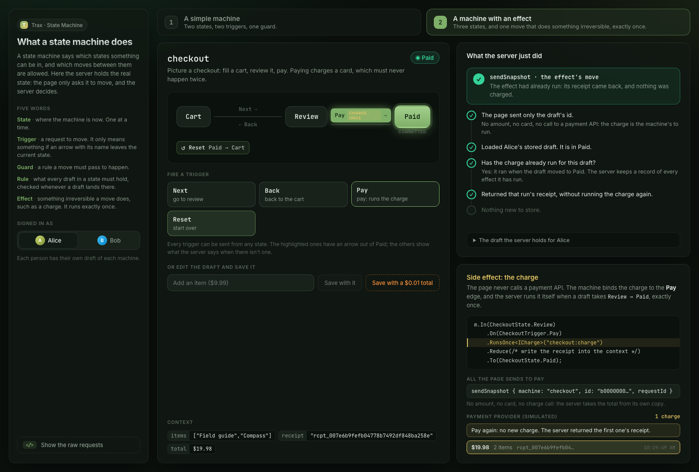

# State Machine sample

A GraphQL host over two portable snapshot state machines, authored declaratively with the fluent API. The host
exposes both, so each is served as its own typed operations under `machines { ... }`: a client starts an instance
with `start`, which mints its id from the machine's declared start, and moves it only with the machine's events, one
mutation each. It shows the whole feature end to end: fluent authoring, one-line
discovery, server-side authority (the server, not the browser, decides every state, down to the checkout total),
and an exactly-once effect.



| Machine | Shape | Notes |
|---|---|---|
| `turnstile` | `Locked ⇄ Unlocked` | No effect, no committed state. The structure proof: `coin(input: { coin })` and `push`. |
| `checkout` | `Cart → Review → Paid` (v2), declarative | A declared start and a rule on every event and read. `AddItem` fills the cart and the server prices it; `Paid` is committed; `Pay` runs one irreversible charge exactly once. v2 adds a `total` that every state requires to equal 999 cents per item, backfilled from v1 drafts by a forward migration (see below). |

Both live in `Trax.Samples.StateMachine` as `Machine<TState, TTrigger>` subclasses. Each is marked
`[TraxMachine]`, so the host (`Trax.Samples.StateMachine.Api`) serves both, and wires them with one line:

```csharp
builder.Services.AddTrax(trax =>
    trax.AddEffects(effects => effects.UsePostgres(connectionString).AddJson())
        .AddStateMachines(                                      // before AddMediator
            o => o.DraftTtl = TimeSpan.FromDays(1),
            typeof(TurnstileMachine).Assembly)
        .AddMediator(typeof(TurnstileMachine).Assembly));

builder.Services.AddScoped<ISnapshotPrincipal, TraxCallerSnapshotPrincipal>();
builder.Services.AddSingleton<SimulatedPaymentProvider>();
builder.Services.AddScoped<ICharge, LoggingCharge>();
```

`AddStateMachines` discovers the machines and wires the store, the effect-claim ledger, the
exactly-once runner, the registry and the trains every machine operation runs through. It must come before
`AddMediator`. `[TraxMachine]` marks the machines clients reach; the generic `stateMachine` mutations are not served. The host
supplies only the two things a machine can't know: how to map its auth to a user key
(`ISnapshotPrincipal`) and the charge implementation.

Alice and Bob are two users every visitor of the demo shares, and the server caps the drafts one user may hold
(50 by default). The host keeps the cap and sets `DraftTtl` to a day, so the instances a walkthrough or a closed
browser leaves behind expire long before a demo database fills it.

## Run it

From `Trax.Samples/`:

```bash
docker compose up -d                             # Postgres 5432, database trax_statemachine
dotnet run --project samples/StateMachine/Trax.Samples.StateMachine.Api
```

Open http://localhost:5280/trax/graphql and send `X-Api-Key: alice-key-do-not-use-in-production`.

```graphql
# What machines are available?
{ discover { stateMachine { listMachines { machines { name hasEffect } } } } }

# Start a checkout. The answer carries the id the server minted: use it as ID below.
mutation {
  machines { checkout { start(requestId: "start-1") { id state context { items total } problem { code } } } }
}

# Add an item (the server prices the cart), review, and charge exactly once.
mutation {
  machines { checkout { addItem(id: "ID", input: { item: "book" }, requestId: "add-1") {
    state context { items total } problem { code } } } }
}

mutation {
  machines { checkout { next(id: "ID", requestId: "next-1") { state problem { code } } } }
}

mutation {
  machines { checkout { pay(id: "ID", requestId: "pay-1") { state context { receipt } problem { code } } } }
}
```

A second `pay` with the same `requestId` returns the same `Paid` answer and does not charge again. No request
carries a total: `addItem` names the item, and the server appends it and computes `total` (999 cents per item). The
host serves no save, so the total is always the server's, and the charge reads the amount from the server's stored
copy (`CheckoutMachine.AmountCents`). `pay` takes no input: the charge produces the receipt. `discard` deletes a
checkout you are done with, and `{ machines { checkout { get(id: "ID") { state } } } }` reads one back.

## Schema evolution (v1 → v2)

`checkout` is version 2: its context is `{ items, receipt, total }`, and every state requires `total`. A draft
written by the old v1 host has no `total`, so it would fail v2 validation. The machine declares a forward migration
inline, so a v1 draft is upgraded on rehydrate:

```csharp
m.Id("checkout").Version(2).StartsAt(CheckoutState.Cart, Fresh)
    .MigrateFrom(1, (state, ctx) =>
    {
        var next = (JsonObject)ctx.DeepClone();
        next["total"] = ItemsCount(ctx) * UnitPriceCents; // backfill from the item count
        return new MigrationResult(state, next);
    });
```

Load a stored v1 draft and the server returns it at v2 with `total` filled in; there is no manual step.
`ForwardMigrationTests` in the E2E suite proves it over GraphQL, and that a v2 context missing `total` is refused,
which is what makes the migration load-bearing.

## Web frontend

A React app in [web/](web/) drives both machines through the client `trax client` generated from this host's
manifest: `useRememberedTurnstile` and `useRememberedCheckout` keep each user's instance, the trains are called through the
page's own documents (`web/src/graphql/`), and every request is sent by the persisted id the host registered. Start this host, then `cd web && npm install && npm run dev` and open
http://localhost:5173. The host allows that origin only, so Vite refuses to start rather than move to
another port while a different sample's client holds 5173.

The page teaches the machine before the example. Each machine has a tab: the turnstile first, as the simplest
machine, then the checkout, a machine with an effect. The page starts each machine once per user and keeps the id
the server minted in the browser, so a reload resumes the same instance. A state diagram follows every move and
marks the moves out of the current state, and every trigger can be sent from any state, so pressing one with no
arrow shows the server's `NO_TRANSITION`. **What the server just did** lists the checks the server made for the
last request, in the order it makes them, and where it stopped (`GUARD_FAILED` for a penny, or for **Next** from an
empty cart). On the checkout, **Fill the cart** sends `AddItem`, and **Side effect: the charge** shows the
`RunsOnce<ICharge>` binding, the whole request the page sends to pay (only the draft's id), and the payment
provider's own list of charges, which grows by one on Pay and not at all on a second Pay. **Show the raw requests**
opens every GraphQL request the page sends.

The charge is the one place a payment happens: `LoggingCharge` takes it from `SimulatedPaymentProvider`, an in-memory
stand-in for a payment gateway, and `payments.listCharges` returns the caller's own charges for the page to show.

## Tests

```bash
dotnet test tests/Trax.Samples.StateMachine.Tests                         # the machines, no database
dotnet test tests/Trax.Samples.StateMachine.E2E                           # the real host over GraphQL
```

`Trax.Samples.StateMachine.E2E` starts this host with `WebApplicationFactory` against the
`statemachine_e2e_tests` database (`docker compose up -d` creates it on a fresh volume) and drives everything
above over `/trax/graphql`: both machines started and moved by their events, the refused transitions, the charge
running once however often `pay` is repeated with one request id, the v1 to v2 migration, the server-owned total, and auth
(anonymous refused, the demo keys only in Development). Set `TRAX_TEST_PG_PORT` when your Postgres is not on 5432.
Without a database it fails; it never skips.

## Notes

- Anonymous requests get a `TRAX_AUTHORIZATION` error at HTTP 200, not a crash. Every machine operation requires
  a signed-in caller; `listMachines` is anonymous so you can inspect the machines without a key.
- The `snapshot_draft` and `effect_claim` tables are created by the Trax Postgres provider's own
  migrations when the host starts; the sample writes no schema of its own.

Docs: <https://traxsharp.net/docs/samples/state-machine>
